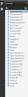

# mkpublisherpack

This utility builds a sheet music publication pack that can be submitted to sheet music resellers. 
It uses the PDF-exported output of a MuseScore composition or arrangement and combines and bookmarks all the parts into a single PDF file,
complete with a front cover page. 

# Synopsys

MuseScore can export all its parts as separate PDF files, as below.
Note that the shortest file name is main (conductor) score.

	$ ls *.pdf
	'Our House - Big Band.pdf'
	'Our House - Big Band - Alto Saxophone 1.pdf'
	'Our House - Big Band - Alto Saxophone 2.pdf'
	'Our House - Big Band - Alto Saxophone 3.pdf'
	'Our House - Big Band - Baritone Saxophone.pdf'
	'Our House - Big Band - Bass Guitar.pdf'
	'Our House - Big Band - Bass Trombone.pdf'
	'Our House - Big Band - Clarinet in Bb 1.pdf'
	'Our House - Big Band - Clarinet in Bb 2.pdf'
	'Our House - Big Band - Drums.pdf'
	'Our House - Big Band - Fluegelhorn.pdf'
	'Our House - Big Band - Flute.pdf'
	'Our House - Big Band - Jazz Guitar.pdf'
	'Our House - Big Band - Piano.pdf'
	'Our House - Big Band - Publisher Pack.pdf'
	'Our House - Big Band - Tenor Saxophone 1.pdf'
	'Our House - Big Band - Tenor Saxophone 2.pdf'
	'Our House - Big Band - Tenor Saxophone 3.pdf'
	'Our House - Big Band - Trombone in Bb 1.pdf'
	'Our House - Big Band - Trombone in Bb 2.pdf'
	'Our House - Big Band - Trombone in C 1.pdf'
	'Our House - Big Band - Trombone in C 2.pdf'
	'Our House - Big Band - Trumpet in Bb 1.pdf'
	'Our House - Big Band - Trumpet in Bb 2.pdf'
	'Our House - Big Band - Tuba in Bb.pdf'
	'Our House - Big Band - Tuba in C.pdf'
	'Our House - Big Band - Tuba in Eb.pdf'
	'Our House - Big Band - Voice.pdf'

The publisher pack shows this on the conver page:

All instrument parts are bookmarked, which allows quick navigation between parts:

# Prerequisites:

You need to have the PDF Toolkit installed, a.k.a. "pdftk", as well as "pandoc".

# Usage:

    mkpublisherpack.sh

# Example:

To create the publisher pack, go to the current working directory to where the PDF parts are, and run this:

    mkpublisherpack.sh

The name of the publisher pack is based on the shortest PDF filename in the directory, which, by default, is the conductor score, as exported as a PDF file by MuseScore.
You would end up with a file called something like this:

    [Composition Name] - Publisher Pack.pdf

Upload this to your chosen sheet music reseller. 
I use https://www.arrangeme.com, who then also re-publish on https://sheetmusicplus.com

# Installation:

Copy these files into your /usr/local/bin directory

    $ chmod +x mkpublisherpack.sh
    $ sudo cp mkpublisherpack.sh /usr/local/bin

# Configuration

Edit the file .attribution. If the file does not exist, it will automatically be created.
The content of this file will appear on the cover page. Example:

    $ cat .attribution
    Arranged for Big Band: Gerrit Hoekstra

    Composers: Cathal Smyth, Chris Foreman
    Original Artists: Madness

# Author:

Gerrit Hoekstra. You can contact me via https://github.com/bignosethethird

# Environmental Notice:

This work was created from 100%-recycled electrons. No animals were hurt during the production of this work, except when I forgot to feed my cats that one time. The cats and I are on speaking terms again.
